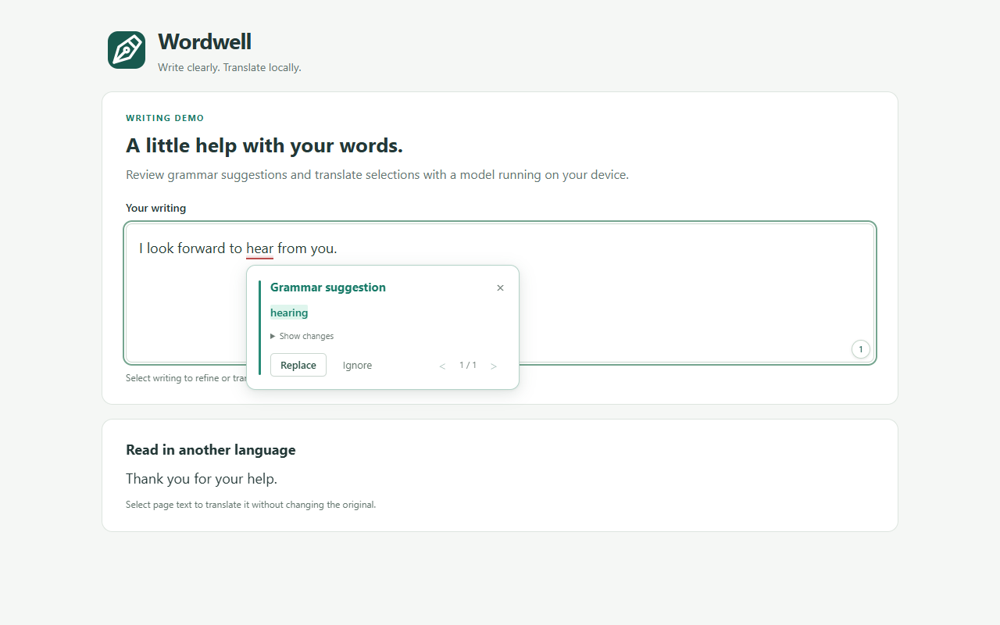
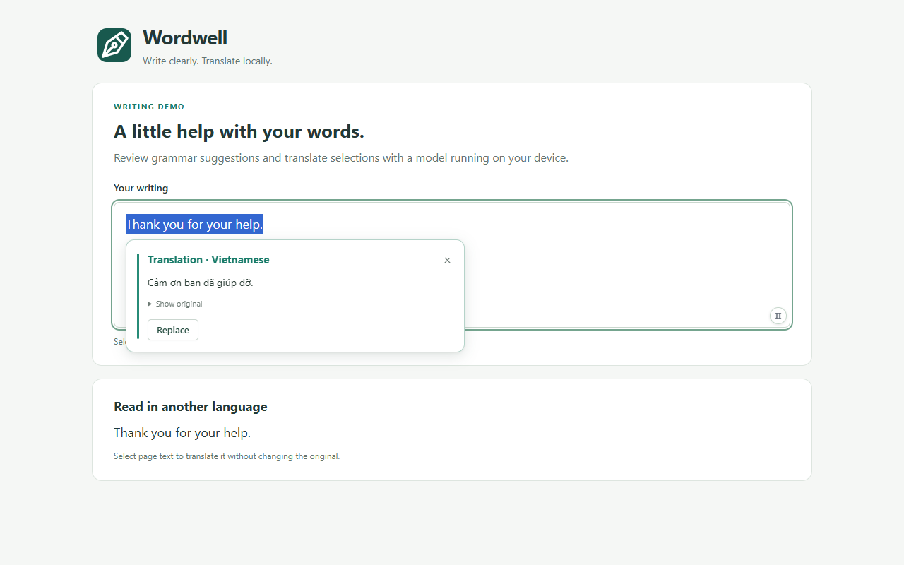
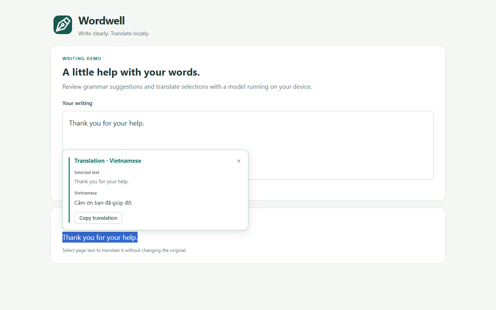

# Wordwell

**Write clearly. Translate locally.**

A Chrome extension for grammar correction and translation, powered by a model running on your device. Your writing stays local, with no account or cloud inference.

- **Grammar suggestions** after a typing pause, with Replace, Ignore, and Undo.
- **Refine selected writing** with a click of the bulb.
- **Translate text boxes** with a preview or optional instant replacement.
- **Translate selected page text** and copy the result.
- **Make it yours** with language settings, editable prompts, and a remembered local model.

[Get started](docs/getting-started.md) · [Development](docs/development.md) · [Privacy](docs/privacy.html) · [Support](https://github.com/ForteDexe/Wordwell/issues)

A compatible GGUF model is required. Suggestions can miss mistakes; review the output.

**Grammar correction**

**Text-box translation**

**Page selection translation**

Licensed under [Apache 2.0](LICENSE). [Third-party notices](NOTICE).
